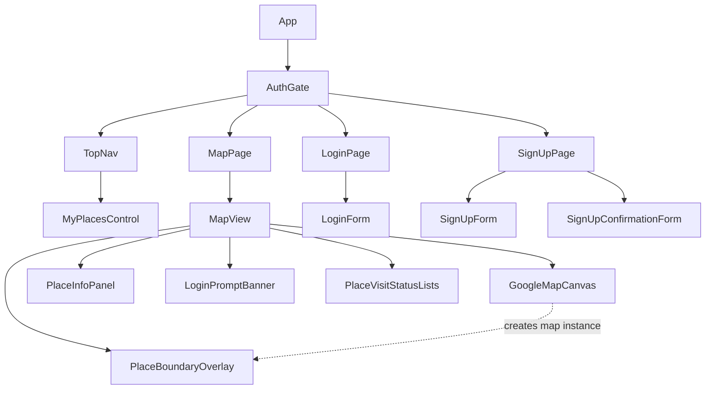
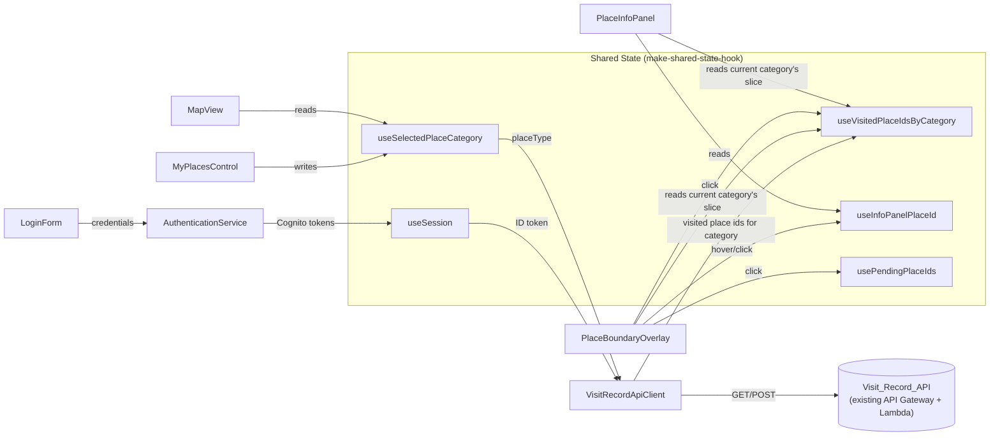
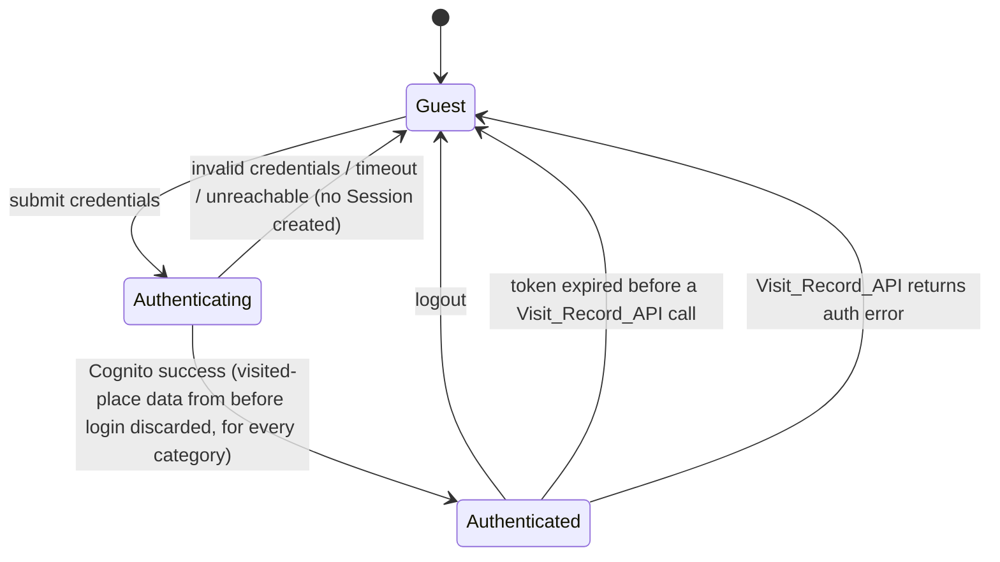
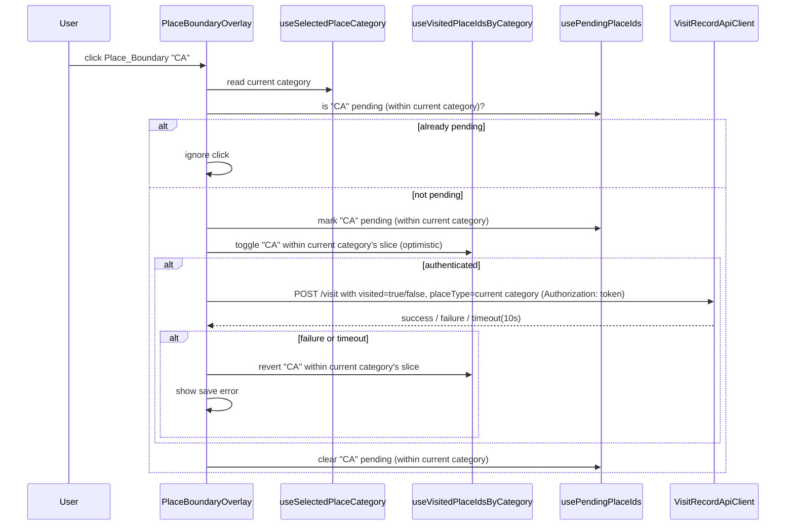
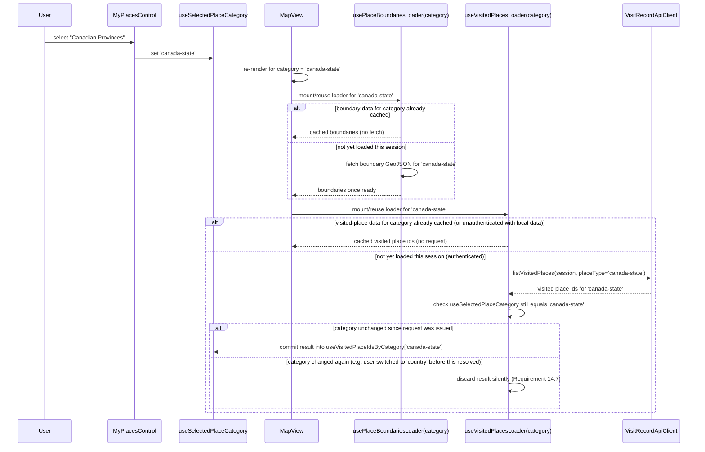

# Design Document: State Visit Tracker (Coordinate Commons Front End)

## Overview

Coordinate Commons is a React single-page application that shows a Google Map of one Place_Category at a time — US states plus Washington D.C. (51 regions), Canadian provinces, or countries — selected via the My_Places_Control in the top navigation. Visitors can click a Place_Boundary to mark or unmark it as "visited." Marks made while signed in are persisted to an existing AWS API Gateway + Lambda backend (the Visit_Record_API), scoped to the signed-in user's AWS Cognito identity. Marks made without signing in live only in memory for that browser session.

This design covers only the front end. The Visit_Record_API and the Cognito user pool already exist; this document defines the contract the front end assumes for them (see "Visit_Record_API Contract" below) but does not design their implementation.

The application is implemented in plain JavaScript (JSX), consistent with the `make-shared-state-hook` library's own examples and its no-framework, minimal-dependency philosophy. No build-time type system (TypeScript, Flow) is assumed or required by this design; PropTypes may optionally be used for component prop validation but are not load-bearing for correctness.

**Terminology note (Requirements 1-12 vocabulary vs. generalized vocabulary)**: Requirements 1-12 were originally written against a US-states-only vocabulary — `State_Boundary`, `Visited_State`, `State_Info_Panel` — before Requirement 13 introduced Canadian provinces and countries as additional Place_Categories. Those requirements' vocabulary is the US-states Place_Category's specific instance of the now-generalized concepts `Place_Boundary`, `Visited_Place`, and `Place_Info_Panel` used throughout this design's code, component, and data-model names (e.g. `State_Boundary` is the `Place_Boundary` for the `us-state` Place_Category). Everywhere this design refers to "the behavior described in Requirement N" for N in 1-12, read it as applying to whichever Place_Category is currently selected, per Requirement 15. The requirements document itself is unchanged; this generalization is purely a design/implementation-naming decision.

### Key Design Decisions

| Decision | Choice | Rationale |
|---|---|---|
| Map rendering | Google Maps JavaScript API, loaded via a small loader hook (no wrapper library like `@react-google-maps/api`) | Requirement 8.2/8.3 mandate the Google Maps JavaScript API directly. A thin loader keeps the dependency surface small and gives full control over overlay lifecycle, matching the project's stated preference for minimal dependencies. |
| Place boundary hit-testing | A single map-level click/mousemove listener plus a pure, testable point-in-boundary lookup function, rather than one Google Maps click listener per polygon | Centralizing hit-testing in a pure function (`resolvePlaceBoundaryAtLatLng`) makes Requirement 3.5/3.6 and Requirement 10's hover behavior property-testable without a real Maps API instance, and gives deterministic behavior when polygons are near shared borders. |
| Authentication | `amazon-cognito-identity-js` (the Cognito Identity SDK) rather than the full AWS Amplify library | The app needs username/password authentication and self-service sign-up (including email confirmation) against an existing user pool, but no hosted UI and no other Amplify categories. `amazon-cognito-identity-js` already exposes `CognitoUserPool.prototype.signUp` and `CognitoUser.prototype.confirmRegistration` directly, so sign-up needs no additional dependency; it remains the lighter-weight, focused choice over pulling in Amplify's broader surface area. |
| Shared state | `make-shared-state-hook`, per Requirement 8.6/8.7 | Mandated by requirements. Per the library's own best practices, state is decomposed into several small hooks (session, selected place category, visited-place ids by category, hovered/last-clicked id, pending-request ids by category) rather than one large object. |
| Visit_Record_API client | A small fetch-based client module, not a generated SDK | The API surface is 2 operations (list, save-with-visited-flag — unmarking reuses the save operation with `visited: false` rather than a separate delete). A hand-written client keeps the Authorization-header and timeout logic in one auditable place (Requirement 7), now parameterized by `placeType` (Requirement 15.2). |
| Place boundary source data | One static GeoJSON asset per Place_Category, each with one Feature per region, each with a stable `placeId`, fetched at runtime via `fetch()` from a static path/CDN URL rather than imported into the JS bundle | Boundaries are fixed reference data, but they are also large relative to the app's core logic. Fetching them at runtime keeps them out of the JS bundle, reducing initial page load size; a category's boundary data loads only once it becomes the Selected_Place_Category, per Requirement 14.5. The Canadian-provinces and countries GeoJSON assets do not yet have a confirmed data source; this is an open question to resolve during implementation, using the same static-asset approach as the existing US-states asset. |
| Place category selection state | A dedicated shared-state hook (`useSelectedPlaceCategory`), read by `TopNav`, `MapView`, and `MapPage`, rather than a prop threaded from `AuthGate` | Requirement 13 lets the user change the Selected_Place_Category from `TopNav`, which is a sibling of `MapPage`/`MapView` in the component tree, not an ancestor — a shared-state hook avoids introducing prop-drilling or lifting this state above `AuthGate`. |
| Per-category caching and stale-response handling | Visited-place and boundary data are stored keyed first by Place_Category, then by placeId; every in-flight request is tagged with the Place_Category it was issued for and checked against the current Selected_Place_Category before its result is committed | Requirement 14.5/14.6 require that switching categories never discards other categories' data and never redundantly re-fetches a category's data, and Requirement 14.7 requires that a late-arriving response for a category the user has since switched away from is discarded. Tagging each request with its issuing category (a simple closure capture, no global counter needed since only one request per category can be in flight at a time — see "Stale Request Discard" below) is the smallest mechanism that satisfies all three. |
| Configuration | A single `config.js` module exported as the sole source of the Visit_Record_API base URL, Cognito settings, and Google Maps API key | Keeps every environment-specific value (which differs between local/dev/staging/prod) in one auditable place, and avoids hardcoding the API's base URL, Cognito pool/client ids, or the Maps key across multiple files. |

## Architecture

### Component Tree



- **App**: Top-level component. Instantiates the shared-state hooks module and renders `AuthGate`.
- **AuthGate**: Reads the shared `useSession` hook and chooses between `MapPage` (default, per Requirement 1.1), `LoginPage`, and `SignUpPage`, via a local `currentPage` enum (`'map' | 'login' | 'signup'`, generalizing the boolean this state used to be now that there are three top-level pages instead of two — see AuthGate.jsx's own module comment for the full navigation-state rationale); renders `TopNav` above whichever page is showing, so navigation is visible on every page.
- **TopNav**: Always-visible top navigation. Provides a home control that returns to `MapPage`, the `MyPlacesControl` (Requirement 13.1), a "Log in" control when there is no session (per Requirement 1.1/1.2), and a "Log out" control when there is a session (invoking the logout handler per Requirement 2.1). Control order left-to-right (DOM order): home control, `MyPlacesControl`, login/logout control (Requirement 13.1); visually, `MyPlacesControl` and the login/logout control are grouped together on the right side of the nav, with the home control on the left.
- **MyPlacesControl**: Reads and writes `useSelectedPlaceCategory`. Renders the fixed label "My Places" as its closed-state button text, and an open dropdown with exactly three options — "US States", "Canadian Provinces", "Countries" — mapping 1:1 to `us-state` / `canada-state` / `country` (Requirement 13.2-13.4), rendered as an absolutely-positioned overlay below the control rather than in normal document flow.
- **MapPage**: Composes `MapView`.
- **MapView**: Reads `useSelectedPlaceCategory` and owns, per the currently Selected_Place_Category, the Google Maps lifecycle (loading, error, retry) and the boundary/visited-place loading lifecycle; renders `GoogleMapCanvas`, `PlaceBoundaryOverlay`, `PlaceInfoPanel`, and — in the area below the map, after `PlaceInfoPanel` and above `PlaceVisitStatusLists` — `LoginPromptBanner`, in all of its loading/error/ready states so the prompt is persistent while unauthenticated (Requirement 9.2/9.3). (This placement was corrected: rendering `LoginPromptBanner` as a `MapPage`-level sibling of `MapView` put it after `PlaceVisitStatusLists`' long columns, i.e. at the page bottom rather than below the map.)
- **PlaceBoundaryOverlay**: Draws the Selected_Place_Category's Place_Boundary polygons on the map and colors them from that category's slice of `useVisitedPlaceIdsByCategory` (Requirement 6, 15.3).
- **PlaceInfoPanel**: Fixed-position panel below the map (Requirement 10, 15.4). Requirement 10's vocabulary calls this the `State_Info_Panel` for the US-states case; see the Overview's terminology note.
- **PlaceVisitStatusLists**: Two side-by-side lists below the map, showing visited (left) and not-visited (right) Place_Boundary names for the Selected_Place_Category, partitioned via `partitionPlaceBoundariesByVisited` (Requirement 11, 15.5).
- **LoginPage / LoginForm**: Username/password form calling `AuthenticationService`; `LoginPage` also renders a "Sign up" link that navigates to `SignUpPage` (Requirement 12.1).
- **SignUpPage / SignUpForm / SignUpConfirmationForm**: Two-step account-creation form calling `AuthenticationService` (Requirement 12); see its own subsection below.

### Data Flow



### Session Lifecycle (Requirements 1, 2, 7)



### Toggle Sequence (Requirements 5, 7, 15)



### Place Category Switch Sequence (Requirement 14)



## Components and Interfaces

### Shared State Module (`sharedState.js`)

Built with `makeSharedStateHook(React, initialValue)`, one hook per independent piece of data (per the library's documented best practice of decomposing state):

```javascript
import React from 'react';
import { makeSharedStateHook } from 'make-shared-state-hook';

// Session: null when signed out, otherwise { username, accessToken, expiresAt }
export const useSession = makeSharedStateHook(React, null);

// The single Place_Category currently displayed and tracked. Defaults to 'us-state' (Requirement 13.3).
export const useSelectedPlaceCategory = makeSharedStateHook(React, 'us-state');

// Visited places, partitioned by Place_Category first, then by placeId, for O(1) membership
// checks scoped to a single category and to keep every other category's data untouched when
// switching (Requirement 14.6, 15.1):
// { [placeCategory]: { [placeId]: true } }
export const useVisitedPlaceIdsByCategory = makeSharedStateHook(React, {
  'us-state': {},
  'canada-state': {},
  country: {},
});

// Hover/last-click info panel target: null | placeId (scoped implicitly to whichever
// category is Selected_Place_Category at read time -- see PlaceInfoPanel below)
export const useInfoPanelPlaceId = makeSharedStateHook(React, null);

// Set of placeIds with an in-flight save request, partitioned by Place_Category the same way
// as useVisitedPlaceIdsByCategory: { [placeCategory]: { [placeId]: true } }
export const usePendingPlaceIds = makeSharedStateHook(React, {
  'us-state': {},
  'canada-state': {},
  country: {},
});

// Non-fatal, user-visible transient error banners (e.g. "update did not save")
export const useToastError = makeSharedStateHook(React, null);
```

`Session` shape:

```javascript
{
  username: string,
  accessToken: string,   // Cognito ID token (JWT)
  expiresAt: number,     // epoch ms; derived from Cognito's expires_in at sign-in time
}
```

`PlaceCategory` type: `'us-state' | 'canada-state' | 'country'` — this is the exact `placeType` string value sent to the Visit_Record_API (Requirement 15.2) and is used verbatim as the key into `useVisitedPlaceIdsByCategory` and `usePendingPlaceIds`.

### Configuration Module (`config.js`)

A single module exporting a plain object (or a small `getConfig()` accessor) with the following shape:

```javascript
export const config = {
  visitRecordApiBaseUrl: string,   // e.g. "https://api.example.com/prod" — base URL for the Lambda/API Gateway backend, distinct from the app's own origin
  googleMaps: {
    apiKey: string,                // Google Maps JavaScript API key
  },
  cognito: {
    userPoolId: string,            // AWS Cognito user pool id
    clientId: string,              // Cognito app client id
    region: string,                // AWS region of the user pool, e.g. "us-east-1"
  },
};
```

This module is the single source of truth for environment-specific values, so that `visitRecordApiClient.js`, `authenticationService.js`, and the Google Maps script loader (`useGoogleMapsLoader()`) all import from it rather than hardcoding values.

These values are build-time/deploy-time configuration (e.g., populated via environment variables at build time, or a static `config.js` checked in per environment) — this design does not prescribe the exact mechanism (env vars vs. per-environment file vs. runtime-fetched JSON), only that all three consumers read from this one module. **Open question / assumption to confirm during implementation**: which mechanism the project prefers for populating these values per environment.

The Google Maps API key and Cognito client id are inherently client-visible (shipped to the browser), and this is expected/acceptable for these particular values — standard for an SPA + Cognito app client without a client secret, and for Google Maps JS API keys restricted by HTTP referrer. This module is not for secrets.

### AuthenticationService (`authenticationService.js`)

Wraps `amazon-cognito-identity-js`. The underlying `CognitoUserPool` is constructed from `config.cognito.userPoolId` and `config.cognito.clientId`, and the SDK is configured for `config.cognito.region`.

```javascript
/**
 * Attempts to authenticate against the configured Cognito user pool.
 * Resolves with a Session object on success.
 * Rejects with { kind: 'INVALID_CREDENTIALS' | 'TIMEOUT_OR_UNREACHABLE' } on failure.
 * Enforces a 10-second timeout (Requirement 1.5, 1.9).
 */
async function login(username, password) { /* ... */ }
```

- Applies the field-length and required-field validation from Requirement 1.3/1.4 via `validateCredentials(username, password)` (pure function, exported separately for testing — see Property 1).
- Never resolves with a Session unless Cognito itself reports success (Property 3).

### VisitRecordApiClient (`visitRecordApiClient.js`)

```javascript
/** Throws/rejects with { kind: 'AUTH_ERROR' | 'TIMEOUT' | 'FAILURE' } as appropriate. */
async function listVisitedPlaces(session, placeCategory) { /* GET, 10s timeout; maps placesVisited[].Id -> placeId[] */ }
async function saveVisitedPlace(session, placeCategory, placeId, visited) { /* POST, 10s timeout */ }
```

`placeCategory` is one of `'us-state' | 'canada-state' | 'country'` (Requirement 15.2) and is sent verbatim as the `placeType` value described below; existing US-states-only call sites continue to work unmodified by always passing `'us-state'` for `placeCategory`, so this parameter addition is backward compatible with the already-implemented behavior.

Request URLs are built as `` `${config.visitRecordApiBaseUrl}/visit` `` rather than a relative path, since the API's base URL differs from the app's own origin. The GET (list) request appends a `?placeType=<placeCategory>` query parameter, required by the real backend; the POST (save) request does not, since it already conveys `placeType` in its JSON body.

Every function:
1. Returns immediately without a network call if `session` is `null` (Requirement 7.2 / Property 16).
2. Attaches `Authorization: <session.accessToken>` to the request (Requirement 7.1 / Property 15).
3. Classifies any `401`/`403` response as `AUTH_ERROR`, letting the caller clear the Session (Requirement 2.3/7.3 / Property 6).
4. Aborts and rejects with `TIMEOUT` if no response arrives within 10 seconds (`AbortController`).

`listVisitedPlaces` parses the response body's `placesVisited` array (each entry `{ "Id": "AZ" }`) and returns the corresponding array of `placeId`s (mapping each entry's `Id` field) for the requested `placeCategory`. `saveVisitedPlace` sends `visited` (`true` to mark, `false` to unmark) and does not use a separate delete call — unmarking reuses the same endpoint.

#### Visit_Record_API Contract (real backend, confirmed)

The backend already exists; this is its actual contract. If the real endpoints are later found to differ further, only `visitRecordApiClient.js` needs to change.

| Operation | Method & Path | Auth | Request Body | Success | Failure |
|---|---|---|---|---|---|
| List visited places | `GET /visit?placeType=<placeType>` | `Authorization: <token>` | none | `200 { "placesVisited": [ { "Id": "AZ" }, ... ] }` (empty array if none) | `401`/`403` → auth error; network/timeout → failure |
| Save/toggle visited place | `POST /visit` | `Authorization: <token>` | `{ "placeId": "IA", "placeType": "<placeType>", "visited": true }` (or `false` to unmark) | `200 { "username": "<user id>", "placeId": "IA", "visited": true }` | `401`/`403` → auth error; other non-2xx/timeout → failure |

`placeType` is one of `us-state`, `canada-state`, or `country`, equal to the `placeCategory` value the request was issued for (Requirement 15.2). There is no delete endpoint. Unmarking a visited place is performed by calling `POST /visit` with `"visited": false` instead of `true`. This is backward compatible with the already-implemented US-states-only integration, which always passes `placeType: "us-state"` (used for both actual states and Washington D.C.).

### PlaceBoundaryData (`placeBoundaries.js` + runtime-fetched GeoJSON, one asset per category)

Place boundary data is fetched at runtime, one static GeoJSON asset per Place_Category, by a loader hook parameterized by category:

```javascript
/** Fetches and parses the boundary GeoJSON asset for the given placeCategory on mount
 *  (or reuses an already-fetched result for that category from the current session --
 *  Requirement 14.5). Exposes status: 'loading' | 'ready' | 'error', and
 *  `placeBoundaries` once ready.
 *  `retry()` re-issues the fetch for that category after a failure. */
function usePlaceBoundariesLoader(placeCategory) {
  // status: 'loading' | 'ready' | 'error'
  // placeBoundaries: PlaceBoundary[] (empty until status === 'ready')
  // retry(): void
}
```

```javascript
// One entry per region within a Place_Category. For 'us-state', placeId is the USPS
// 2-letter code ("DC" for the district); for 'canada-state' and 'country', placeId is
// whatever stable identifier that category's boundary source uses (to be confirmed
// during implementation once a data source for those two categories is selected).
{ placeId: 'CA', name: 'California', polygons: [[[lng, lat], ...], ...] }
```

```javascript
/** Pure function used for click hit-testing and (indirectly) hover, operating on a
 *  single category's placeBoundaries array (the Selected_Place_Category's, in practice).
 *  Returns the placeId whose boundary contains latLng, or null. */
function resolvePlaceBoundaryAtLatLng(latLng, placeBoundaries) { /* ray-casting point-in-polygon */ }
```

`resolvePlaceBoundaryAtLatLng` remains a pure function operating on a single `placeBoundaries` array once that category's `usePlaceBoundariesLoader(placeCategory)` reports `ready`; it is the single source of truth backing Requirement 3.5/3.6 (applied to the Selected_Place_Category per Requirement 15.7), so it is exercised directly by Property 7 without needing a live Google Maps instance or a live fetch. `MapView` only ever calls it with the Selected_Place_Category's boundaries (Requirement 14.1).

**Boundary data source (resolved, upgraded)**: all three categories now source from [Natural Earth](https://www.naturalearthdata.com/)`s 1:50m resolution cultural vector data (public domain), via the [nvkelso/natural-earth-vector](https://github.com/nvkelso/natural-earth-vector) GeoJSON mirror. The `us-state` (51 features, USPS codes incl. DC) and `canada-state` (13 provinces/territories) assets are both filtered from `ne_50m_admin_1_states_provinces.geojson` (by `iso_a2` = `US`/`CA`, using each feature`s `postal` code as `stateId`). The `country` asset (242 features, ISO 3166-1 alpha-3 codes as `stateId`, falling back to `ADM0_A3` for the 8 features lacking a valid `ISO_A3`) is filtered from `ne_50m_admin_0_countries.geojson`. All three were transformed offline into the same `{properties: {stateId, name}, geometry}` FeatureCollection shape that `parseRegionsFromGeoJson` already expects (coordinates rounded to 5 decimal places, ~1.1m precision, to trim file size without visible quality loss), so no parsing logic changed. This replaces an earlier, lower-resolution placeholder-quality source for `canada-state`/`country` (180 countries, blockier shapes) once the visual quality was reported as insufficient even at overview zoom; `us-state` was upgraded at the same time for consistency. Fetched asset sizes: `us-state` ~239KB, `canada-state` ~293KB, `country` ~2.0MB (country is a materially larger one-time fetch than before, judged an acceptable tradeoff for the quality gain).

### Place Category Selection (`MyPlacesControl`, `useSelectedPlaceCategory`)

```javascript
// The three selectable options, in dropdown display order, each mapped 1:1 to a PlaceCategory.
const PLACE_CATEGORY_OPTIONS = [
  { placeCategory: 'us-state', label: 'US States' },
  { placeCategory: 'canada-state', label: 'Canadian Provinces' },
  { placeCategory: 'country', label: 'Countries' },
];
```

`MyPlacesControl` is a standard controlled dropdown/menu component:
- Renders the fixed label "My Places" as its closed-state button text, regardless of the current `useSelectedPlaceCategory()` value (Requirement 13.4).
- On open, marks (e.g. via `aria-checked`/a checkmark) whichever option matches the current Selected_Place_Category (Requirement 13.4).
- On selecting an option, calls `useSelectedPlaceCategory`'s setter with that option's `placeCategory` — even if it matches the value already in effect (Requirement 13.5's "regardless of whether the selected option matches...already in effect") — and requests navigation to `MapPage` via the same navigation callback prop `TopNav`'s home control already uses, regardless of which page was showing (Requirement 13.5).
- On dismissing the dropdown without selecting (e.g. clicking outside, pressing Escape), closes the dropdown without calling the setter and without requesting navigation (Requirement 13.7).
- Does not read `useSession`, so it renders identically for authenticated and unauthenticated users (Requirement 13.6, matching the `StateInfoPanel`/`PlaceVisitStatusLists` pattern of session-independent components).
- Renders the open dropdown as an absolutely-positioned overlay anchored below the closed-state control (the control's container is the positioning context), so it floats on top of whatever page content sits beneath it rather than displacing that content's layout (Requirement 13.2). Each of the three options still renders on its own line within the overlay; only the positioning mechanism (absolute instead of static/inline) changes.

### MapView / PlaceBoundaryOverlay

- Reads `useSelectedPlaceCategory()` once per render; every loader, boundary array, and visited-place slice described below is selected using that value, so at most one category's data is ever rendered (Requirement 14.1).
- Loads the Google Maps JavaScript API script once (shared loader hook `useGoogleMapsLoader()`, unaffected by Place_Category), exposing `status: 'loading' | 'ready' | 'error'`, and independently loads the Selected_Place_Category's boundary data via `usePlaceBoundariesLoader(selectedPlaceCategory)`, exposing its own `status: 'loading' | 'ready' | 'error'` per category (Requirement 14.2). `useGoogleMapsLoader()` builds the script-tag URL using `config.googleMaps.apiKey` rather than a hardcoded key. The Map_View's loading indicator (Requirement 3.3, applied per Requirement 14.2) SHALL remain visible while either the map script or the Selected_Place_Category's boundary fetch is still loading for the first time this session, and SHALL clear only once both report `ready`. The error/retry control (Requirement 3.4/14.3) SHALL appear if either fails, identifies which one failed (map script, boundary data, or both), and its retry action re-attempts whichever of the two is still in an `error` state, for the currently Selected_Place_Category.
- On both `useGoogleMapsLoader()` and `usePlaceBoundariesLoader(selectedPlaceCategory)` reporting `ready`, creates one `google.maps.Map` fitted (via fixed center/zoom, not `fitBounds`, to avoid a load-order race) to a viewport appropriate for the Selected_Place_Category; for `us-state` this viewport includes Alaska and Hawaii (Requirement 3.1). **Open item**: the fixed center/zoom values for `canada-state` and `country` are to be determined during implementation once boundary data for those categories is available; this design only fixes the mechanism (a per-category fixed viewport), not the `canada-state`/`country` values themselves.
- Renders each of the Selected_Place_Category's Place_Boundary entries as a `google.maps.Polygon`, with fill color derived from `resolveFillColor(placeId, visitedPlaceIds)`, where `visitedPlaceIds` is `useVisitedPlaceIdsByCategory()[selectedPlaceCategory]` — i.e., only that category's slice (Property 14, Requirement 15.3).
- Registers exactly one `click` and one `mousemove`/`mouseout` listener on the `Map` object (not per-polygon), converts the event's `latLng` via `resolvePlaceBoundaryAtLatLng` against the Selected_Place_Category's boundaries, and:
  - on click: invokes the toggle handler described below if a boundary was hit; does nothing otherwise (3.6).
  - on mousemove: updates `useInfoPanelPlaceId` when the hit boundary changes; on mouseout (or moving to no boundary), clears it unless the device is touch-only (10.8 — see PlaceInfoPanel); also updates the hovered Place_Boundary's border to a thicker stroke weight, restoring the previous border weight when the hover target changes or clears (Requirement 10.9).
- When `selectedPlaceCategory` changes, the previously rendered category's polygons, listeners, and map overlays are torn down as part of the normal re-render (new `usePlaceBoundariesLoader`/`resolvePlaceBoundaryAtLatLng` inputs), so that Place_Boundary overlays for at most one Place_Category are ever attached to the map (Requirement 14.1).

#### Toggle Handler (`handlePlaceBoundaryClick`)

Pure orchestration function (session, placeCategory, visitedPlaceIdsForCategory, pendingPlaceIdsForCategory, placeId, apiClient) → the next `{ visitedPlaceIdsForCategory, pendingPlaceIdsForCategory }` and the API call to issue, isolated from the DOM so it is directly property-testable (Properties 10, 11, 12, 13). The caller (`PlaceBoundaryOverlay`) is responsible for reading/writing only the Selected_Place_Category's slice of `useVisitedPlaceIdsByCategory`/`usePendingPlaceIds` when invoking this function and applying its result (Requirement 15.6):

1. If `placeId` is in `pendingPlaceIdsForCategory`, no-op (5.4).
2. Otherwise, flip membership of `placeId` in `visitedPlaceIdsForCategory` immediately, mark `placeId` pending in `pendingPlaceIdsForCategory`. No other category's slice is read or written (15.6).
3. If `session` is present, issue a single `saveVisitedPlace(session, placeCategory, placeId, visited)` call with `visited` set to the new membership state (`true` when marking visited, `false` when unmarking), sending `placeCategory` as the `placeType` in effect at the time of the click (15.2); on failure/timeout, flip `placeId` back and set `useToastError`; either way, clear `placeId` from pending when the call settles (5.1–5.4).
4. If `session` is absent, skip step 3 entirely — no API call is made (5.5/5.6).

### PlaceInfoPanel

Rendered once, in a fixed position below `MapView`'s map element (not attached to the cursor), per 10.1. Requirement 10's own text refers to this as the `State_Info_Panel` for the US-states case; see the Overview's terminology note.

```javascript
/** Pure function: what should the panel show right now, for a single category's data?
 *  Returns { placeId: null } | { placeId, name, visited: boolean } */
function computeInfoPanelContent(infoPanelPlaceId, placeBoundariesById, visitedPlaceIds) { /* ... */ }
```

- `infoPanelPlaceId` is updated by hover (mousemove/mouseout on the map) on hover-capable devices, and by click on touch-only devices (detected once via `matchMedia('(hover: hover) and (pointer: fine)')`, consistent with Requirement 10.8) — this is the only place device capability is branched; `computeInfoPanelContent` itself is agnostic to how `infoPanelPlaceId` was set (Property 21).
- `PlaceInfoPanel` calls `computeInfoPanelContent` with `placeBoundariesById` and `visitedPlaceIds` both scoped to the current `useSelectedPlaceCategory()` value only — the Selected_Place_Category's boundaries-by-id map and its slice of `useVisitedPlaceIdsByCategory` (Requirement 15.4). Because `computeInfoPanelContent` is a pure function of shared-state values, it re-renders whenever that category's slice of `useVisitedPlaceIdsByCategory` changes even without pointer movement (10.6 / Property 20).
- When `useSelectedPlaceCategory` itself changes, `infoPanelPlaceId` is reset to `null` (no boundary is highlighted across a category switch), since a placeId from the previous category has no defined meaning against the new category's boundaries.

### PlaceVisitStatusLists

Rendered by `MapView` below the map, as a sibling of `GoogleMapCanvas`/`PlaceBoundaryOverlay`/`PlaceInfoPanel` (Requirement 11, 15.5). Reads `useVisitedPlaceIdsByCategory` and `useSelectedPlaceCategory` itself (matching `PlaceInfoPanel`'s pattern of reading shared state directly) and reuses the `placeBoundaries` array `MapView` already holds from its own `usePlaceBoundariesLoader(selectedPlaceCategory)` call rather than fetching the boundary GeoJSON a second time.

```javascript
/** Pure function: splits placeBoundaries into visited/not-visited lists using a single
 *  category's visited-id map.
 *  Returns { visited: PlaceBoundary[], notVisited: PlaceBoundary[] }, sorted alphabetically by name. */
function partitionPlaceBoundariesByVisited(placeBoundaries, visitedPlaceIds) { /* ... */ }
```

Like `PlaceInfoPanel`, this component does not read `useSession`, so it is available regardless of authentication state (Requirement 11.4). Because it re-renders on any change to the Selected_Place_Category's slice of `useVisitedPlaceIdsByCategory`, moving a place between the two lists after a map click requires no additional event wiring (Requirement 11.3; Property 22). It is called with only the Selected_Place_Category's `placeBoundaries` and visited-id slice (Requirement 15.5).

### LoginPage / LoginForm

- Client-side validation via `validateCredentials` (shared with `AuthenticationService`) blocks submission and shows "both fields are required" (or the appropriate length message) without calling Cognito (1.3/1.4).
- While `login()` is pending: submit control disabled, loading indicator shown (1.10).
- On `INVALID_CREDENTIALS`: shows "username or password is invalid", stays on Login_Page (1.8).
- On `TIMEOUT_OR_UNREACHABLE`: shows "login attempt could not be completed", re-enables submit, stays on Login_Page (1.9).
- On success: calls a callback that sets `useSession`, clears every category's slice of `useVisitedPlaceIdsByCategory` back to `{}` (Requirement 1.6, applied across all Place_Categories since the discard-on-login behavior is not itself category-scoped), and navigates to `MapPage`, which itself triggers the Requirement 4 load for the Selected_Place_Category (1.6/1.7).
- Renders a "Sign up" link below `LoginForm`. Clicking it calls the `onRequestSignUp` callback prop, which `AuthGate` wires to navigate to `SignUpPage` (Requirement 12.1/12.2) — `LoginPage` itself has no navigation state, matching how it already relies on `AuthGate` for the login-success navigation above.

### Sign_Up_Page / SignUpForm / SignUpConfirmationForm

`SignUpPage` owns a two-step local state machine (`'fields' | 'confirming'`) and the actual `signUp()`/`confirmSignUp()` calls; `SignUpForm` and `SignUpConfirmationForm` each own only their own fields, client-side validation, and pending/disabled/loading UI — the same split `LoginPage`/`LoginForm` already establish.

- **Step 1 ('fields', initial)**: renders `SignUpForm`, collecting username, email, an optional location, password, and password confirmation (Requirement 12.3). Client-side validation via `validateSignUpFields(username, email, password, confirmPassword)` (exported from `authenticationService.js`, alongside `validateCredentials`) blocks submission and shows the appropriate message — required fields, length limits, invalid email format, or password/confirmation mismatch (Requirement 12.4–12.7) — without calling Cognito.
- On submitting valid fields, `SignUpPage` calls `signUp(username, email, password, location)`, which wraps `CognitoUserPool.prototype.signUp`, enforces the same 10-second timeout pattern as `login()`, and sends `email` as a standard Cognito attribute always, and `custom:location` only when `location` is non-empty after trimming (Requirement 12.3, 12.8). It resolves with `{ username }` on success, or rejects with `{ kind: 'USERNAME_EXISTS' | 'INVALID_PASSWORD' | 'TIMEOUT_OR_UNREACHABLE' }`, mapped by `SignUpPage` to the corresponding message (Requirement 12.13, 12.14, 12.16) — never leaking raw Cognito errors, matching the `login()`/Requirement 8.5 convention.
- **Step 2 ('confirming')**: on a successful `signUp()`, `SignUpPage` transitions to rendering `SignUpConfirmationForm`, a single confirmation-code field with its own pending/disabled/loading UI (Requirement 12.9, 12.17). Submitting a non-empty code calls `confirmSignUp(username, code)`, which wraps `CognitoUser.prototype.confirmRegistration` with the same 10-second timeout pattern, resolving on success or rejecting with `{ kind: 'INVALID_CODE' | 'TIMEOUT_OR_UNREACHABLE' }` (Requirement 12.10, 12.15, 12.16).
- On successful confirmation, `SignUpPage` shows a brief success indication and calls the `onSignUpComplete` callback prop — it does not navigate itself, matching the callback-prop-driven pattern `LoginPage`/`MapPage`/`TopNav` already use with `AuthGate`. `AuthGate` wires `onSignUpComplete` to navigate back to `LoginPage`. Critically, neither `signUp()` nor `confirmSignUp()` ever touches `useSession` — sign-up and confirmation only create and confirm the Cognito account; they never authenticate it, so Requirement 1's existing login flow remains the only path that creates a Session (Requirement 12.12).

### LoginPromptBanner

Rendered by `MapView` in the area below the map (after `PlaceInfoPanel`, above `PlaceVisitStatusLists`), in all of `MapView`'s loading/error/ready states, whenever `useSession` is `null` (9.2), never when it is non-null (9.3). Additionally distinguishes *why* the user is signed out when the transition to `null` was caused by expiration or an auth error, versus manual logout, by reading a short-lived `signOutReason` value (`'LOGOUT' | 'SESSION_ENDED'`) set alongside the session clear (2.4). Rendered the same way regardless of the Selected_Place_Category (Requirement 15.8).

The neutral (non-`SESSION_ENDED`) message renders "Log in" and "sign up for an account" as links (9.2), using the same `<a href="#">` + `preventDefault()` link-styled-action pattern as `TopNav`/`LoginPage`. The banner has no navigation concept of its own: the links call `onRequestLogin`/`onRequestSignUp` callback props forwarded `AuthGate` → `MapPage` → `MapView` → `LoginPromptBanner` (MapPage and MapView are pure pass-throughs; the banner's placement lives in `MapView`), wired to `AuthGate`'s existing `currentPage` transitions to `'login'` and `'signup'`. The `SESSION_ENDED` message remains plain text with no links (2.4 unchanged).

### Place Category Data Loading (`useVisitedPlacesLoader`, per-category caching, stale-request discard)

`useVisitedStatesLoader.js` generalizes to `useVisitedPlacesLoader.js`, parameterized by `placeCategory`:

```javascript
/** Loads (or reuses an already-loaded/in-flight result for) the given placeCategory's
 *  Visited_Place records.
 *  Exposes status: 'loading' | 'ready' | 'error' (per category) and retry().
 *  Mounted/consulted by MapView with placeCategory = the current useSelectedPlaceCategory()
 *  value; internally keyed by placeCategory so mounting it for a category that has
 *  already loaded (or is already loading) this session reuses that state instead of
 *  issuing a new request (Requirement 14.5). */
function useVisitedPlacesLoader(placeCategory) { /* ... */ }
```

Behavior, per category:

1. **First selection this session (authenticated)**: issues `listVisitedPlaces(session, placeCategory)` with a 10-second timeout (Requirement 4.1/14.2 applied per category); while pending, that category's `status` is `'loading'`.
2. **First selection this session (unauthenticated)**: skips the Visit_Record_API call entirely and initializes that category's slice of `useVisitedPlaceIdsByCategory` as empty unless local marks already exist for it from the current browser session (Requirement 4.7 applied per category).
3. **Success**: replaces exactly that category's slice of `useVisitedPlaceIdsByCategory` with the returned `placeId`s (including empty), leaving every other category's slice untouched (Requirement 4.3/14.6).
4. **Failure/timeout**: that category's `status` becomes `'error'`; `MapView` shows the Requirement 4.4/14.4 error+retry control while that category remains selected; `retry()` re-issues the request for that category.
5. **Re-selecting an already-loaded (or already-failed-then-retried-successfully) category**: no new request is issued; the cached slice is displayed immediately (Requirement 14.5, Property mapping below).

#### Stale Request Discard (Requirement 14.7)

Each request issued by `useVisitedPlacesLoader(placeCategory)` (and, analogously, by `usePlaceBoundariesLoader(placeCategory)`) is a plain `async` call whose continuation closes over the exact `placeCategory` value it was issued for. Because only one request per category can be in flight at a time (re-selecting a category that is already `'loading'` does not issue a second request), no separate generation counter is needed — the closure-captured `placeCategory` itself is the tag. When the request settles:

1. Read the current value of `useSelectedPlaceCategory()`.
2. If it no longer equals the `placeCategory` the request was issued for, discard the result: do not write to `useVisitedPlaceIdsByCategory`/`usePlaceBoundariesLoader`'s cache, and do not transition that category's `status` away from whatever it already was. The result is simply dropped.
3. Otherwise, commit the result as described above (success → replace that category's slice; failure → that category's `status` becomes `'error'`).

This still allows the request to finish populating that category's *own* cache entry for a later, independent re-selection in some designs; this design intentionally keeps it simple and fully discards the stale result per Requirement 14.7's literal wording ("SHALL discard the result of that in-progress request without rendering it or storing it"), meaning a category left before its first load completes will re-fetch from scratch the next time it is selected.

## Data Models

<!-- Note: config.js's shape is documented in its own subsection above ("Configuration Module") and is not part of Shared_State_Store — it holds build/deploy-time settings, not application state. -->

```javascript
// Session (see Shared State Module above)
Session = null | {
  username: string,
  accessToken: string,
  expiresAt: number,
}

// PlaceCategory (see Shared State Module above)
PlaceCategory = 'us-state' | 'canada-state' | 'country'

// PlaceBoundary (static reference data per category; PlaceBoundary[] for a given category is
// populated asynchronously via usePlaceBoundariesLoader(placeCategory)'s runtime fetch rather
// than a static import). A State_Boundary (Requirements 1-12's vocabulary) is the PlaceBoundary
// for the 'us-state' category.
PlaceBoundary = {
  placeId: string,        // stable id within its category; USPS code ("DC" for the district) for 'us-state'
  name: string,            // e.g. "California"
  polygons: number[][][]   // one or more linear rings of [lng, lat] pairs
}

// Visited-place membership, partitioned by Place_Category (Shared_State_Store).
// A Visited_State (Requirements 1-12's vocabulary) is a Visited_Place entry under 'us-state'.
VisitedPlaceIdsByCategory = {
  [placeCategory: PlaceCategory]: { [placeId: string]: true }   // absent key == not visited
}

// Pending-request membership, partitioned by Place_Category the same way.
PendingPlaceIdsByCategory = {
  [placeCategory: PlaceCategory]: { [placeId: string]: true }
}

// Visit_Record_API response shapes (see contract table) — two distinct shapes, identical
// across all three Place_Categories:
// List response entry: { Id: string }                      // e.g. { "Id": "AZ" }
// Save response:        { username: string, placeId: string, visited: boolean }
// VisitRecordApiClient normalizes both into the internal per-category VisitedPlaceIdsByCategory
// slice (keyed by placeId), so callers never see these raw shapes directly.
VisitedPlaceListEntry = { Id: string }
VisitedPlaceSaveResponse = { username: string, placeId: string, visited: boolean }
```

## Correctness Properties

*A property is a characteristic or behavior that should hold true across all valid executions of a system—essentially, a formal statement about what the system should do. Properties serve as the bridge between human-readable specifications and machine-verifiable correctness guarantees.*

### Property 1: Credential validation accepts only well-formed, non-empty input

For any generated username and password strings, `validateCredentials(username, password)` accepts if and only if both are non-empty after trimming and within their maximum lengths (username ≤ 128 characters, password ≤ 256 characters); otherwise it rejects with a required-fields or length message.

**Validates: Requirements 1.3, 1.4**

### Property 2: Successful login discards prior visited-place data for every category

For any prior `VisitedPlaceIdsByCategory` value (including all-empty) and any successful Cognito authentication result, applying the login-success handler always yields a `VisitedPlaceIdsByCategory` whose every category's slice is `{}`, and a non-null `Session` populated from that result.

**Validates: Requirements 1.6**

### Property 3: A failed or unreachable authentication attempt never creates a Session

For any Cognito outcome classified as invalid credentials, timeout, or unreachable, applying the login handler to any prior `Session` value always yields `Session === null` and never a populated Session.

**Validates: Requirements 1.8, 1.9, 8.5**

### Property 4: Logout always clears session and visited-place data for every category

For any prior `Session` (including null) and any prior `VisitedPlaceIdsByCategory` value, applying the logout handler always yields `Session === null` and every category's slice of `VisitedPlaceIdsByCategory` equal to `{}`.

**Validates: Requirements 2.1**

### Property 5: An expired ID token blocks the API call and clears the session

For any `Session` whose `expiresAt` is before the current time, attempting any Visit_Record_API operation for any Place_Category never issues a network request, and always clears the Session.

**Validates: Requirements 2.2**

### Property 6: An authentication-error response always clears the session

For any Visit_Record_API response classified as an authentication error (401/403), the response handler always clears the Session, regardless of which operation (list/save) or which Place_Category produced it.

**Validates: Requirements 2.3, 7.3**

### Property 7: Place boundary hit-testing resolves clicks to exactly the containing boundary, or none

For any generated latitude/longitude point and any set of non-overlapping Place_Boundary polygons (for a single Place_Category), `resolvePlaceBoundaryAtLatLng` returns the `placeId` of the one boundary whose polygon contains that point, or `null` if no boundary's polygon contains it.

**Validates: Requirements 3.5, 3.6**

### Property 8: Loading visited places for a category replaces that category's slice with exactly what the API returned

For any prior `VisitedPlaceIdsByCategory` value and any list of `placeId`s returned by the Visit_Record_API for a given `placeCategory` (including the empty list), the load-success handler always results in that category's slice containing exactly that returned list of keys, regardless of what was present before the response arrived, and leaves every other category's slice unchanged.

**Validates: Requirements 4.3, 14.6**

### Property 9: Guest initialization never calls the API and preserves local marks

For any pre-existing local (session-only) visited-place slice for a given Place_Category and an unauthenticated session, initializing the Map_View for a guest for that Place_Category always results in that category's slice unchanged from its prior local value, and issues zero calls to the Visit_Record_API client.

**Validates: Requirements 4.7**

### Property 10: Clicking a place as an authenticated user always toggles it and issues the matching request

For any authenticated `Session`, any Place_Category, any `placeId` not currently pending within that category, and its current visited membership, `handlePlaceBoundaryClick` always flips that `placeId`'s membership in that category's slice of `visitedPlaceIdsByCategory` and issues a `saveVisitedPlace` request with that category's `placeType` and `visited: true` if it was being marked visited, or `visited: false` if it was being unmarked.

**Validates: Requirements 5.1, 5.2, 15.2**

### Property 11: A failed or timed-out save always reverts the optimistic update

For any authenticated `Session`, any Place_Category, any `placeId`, and a Visit_Record_API save call mocked to fail or time out, the resulting visited membership for that `placeId` within that category always equals its value immediately before the click, and a save-error is surfaced.

**Validates: Requirements 5.3**

### Property 12: Repeated clicks on a pending place have no additional effect

For any Place_Category, any `placeId` already marked pending within that category, and any number of additional click events dispatched on it before the in-flight request settles, that category's visited-membership slice and the count of issued API calls for that `placeId` remain exactly what they were after the first click (idempotence of repeated clicks while pending).

**Validates: Requirements 5.4**

### Property 13: Clicking a place as an unauthenticated user always toggles it locally and never calls the API

For any unauthenticated session, any Place_Category, any `placeId` not currently pending within that category, and its current visited membership, `handlePlaceBoundaryClick` always flips that `placeId`'s membership within that category's slice and issues zero calls to the Visit_Record_API client.

**Validates: Requirements 5.5, 5.6**

### Property 14: Fill color is exactly one of two fixed, distinct colors, determined solely by membership in the current category's slice

For any `placeId` and any single-category `visitedPlaceIds` map (i.e. one category's slice of `visitedPlaceIdsByCategory`), `resolveFillColor(placeId, visitedPlaceIds)` returns the visited-fill-color if and only if `placeId` is a key in `visitedPlaceIds`, and otherwise returns the not-visited-fill-color; the two colors are never equal.

**Validates: Requirements 6.1, 6.3, 15.3**

### Property 15: Every Visit_Record_API request carries the session's ID token as the Authorization header

For any non-null `Session`, any Place_Category, and any of the two operations (list/save), the outgoing request's `Authorization` header always equals `session.accessToken`.

**Validates: Requirements 7.1**

### Property 16: No session means no request is ever sent

For any of the two Visit_Record_API operations invoked with `session === null`, for any Place_Category, the underlying transport (fetch) is never called, and the function resolves/rejects without a network round trip.

**Validates: Requirements 7.2**

### Property 17: The login prompt is visible exactly when there is no session

For any `Session` value (`null` or populated) and any Selected_Place_Category, `shouldShowLoginPrompt(session)` returns `true` if and only if `session === null`.

**Validates: Requirements 9.2, 9.3, 15.8**

### Property 18: The info panel always displays the currently targeted place's name and visited status from the current category's slice

For any non-null `infoPanelPlaceId` that identifies a known Place_Boundary within a given category, and any single-category `visitedPlaceIds` map for that category, `computeInfoPanelContent` returns that place's name and a `visited` flag equal to the place's membership in `visitedPlaceIds` — including when `infoPanelPlaceId` changes directly from one place to a different one.

**Validates: Requirements 10.2, 10.4, 15.4**

### Property 19: The info panel shows the neutral placeholder whenever nothing is targeted

For any single-category `visitedPlaceIds` map, `computeInfoPanelContent(null, placeBoundariesById, visitedPlaceIds)` always returns the placeholder content (no name, no visited status).

**Validates: Requirements 10.3, 10.5**

### Property 20: The info panel reflects visited-status changes for the currently targeted place without re-targeting

For any fixed `infoPanelPlaceId` targeting a known Place_Boundary, and any two single-category `visitedPlaceIds` maps (for the same category) that differ only in that place's membership, `computeInfoPanelContent` returns a different `visited` flag matching each map, with `placeId`/`name` unchanged.

**Validates: Requirements 10.6**

### Property 21: On hover-incapable devices, the info panel always reflects the most recent click

For any sequence of one or more clicked `placeId`s on a simulated touch-only device, `infoPanelPlaceId` after the sequence always equals the last `placeId` in that sequence, regardless of any hover-like events interleaved in the sequence.

**Validates: Requirements 10.8**

### Property 22: The visited/not-visited lists partition exactly the currently loaded places (for the current category) by membership

For any list of loaded Place_Boundary entries for a single category and that category's `visitedPlaceIds` map, `partitionPlaceBoundariesByVisited(placeBoundaries, visitedPlaceIds)` returns two lists whose union (regardless of order) equals exactly the input `placeBoundaries`, with each entry appearing in the `visited` list if and only if its `placeId` is a key of `visitedPlaceIds`, and in the `notVisited` list otherwise -- no place is duplicated or omitted.

**Validates: Requirements 11.2, 11.3, 15.5**

### Property 23: The hovered place's border is thicker than every other place's border, and only on hover-capable devices

For any sequence of hover (mousemove/mouseout) events on a hover-capable device, at most one Place_Boundary's polygon has the thickened stroke weight at any time -- exactly the currently hovered place's, if any -- and every other Place_Boundary's polygon has the default stroke weight; on a hover-incapable (touch-only) device, no Place_Boundary's polygon ever receives the thickened stroke weight regardless of pointer movement.

**Validates: Requirements 10.9**

### Property 24: Sign-up field validation accepts only well-formed, non-empty input

For any generated username, email, password, and password-confirmation strings, `validateSignUpFields(username, email, password, confirmPassword)` accepts if and only if all four are non-empty after trimming, within their maximum lengths (username ≤ 128, email ≤ 254, password and confirmPassword ≤ 256 characters), `email` looks like a well-formed email address, and `password` equals `confirmPassword` after trimming; otherwise it rejects with the corresponding required-fields, length, invalid-email, or password-mismatch reason.

**Validates: Requirements 12.4, 12.5, 12.6, 12.7**

### Property 25: Successful sign-up and confirmation never creates a Session

For any valid sign-up fields and any Cognito outcome in which both `signUp()` and `confirmSignUp()` succeed, applying the sign-up and confirmation handlers to any prior `Session` value (including null) always leaves `Session` unchanged, and never a newly populated Session — only Requirement 1's login flow can transition `Session` from null to non-null.

**Validates: Requirements 12.12**

### Property 26: Selecting a My_Places_Control option always sets the Selected_Place_Category to a defined value, and dismissing never changes it

For any of the three `PLACE_CATEGORY_OPTIONS` and any prior `Selected_Place_Category` value, selecting that option always results in `useSelectedPlaceCategory()` equal to that option's `placeCategory` (never left unset), for all three options; and for any prior `Selected_Place_Category` value, dismissing the open dropdown without selecting an option always leaves `useSelectedPlaceCategory()` and the currently displayed page unchanged.

**Validates: Requirements 13.5, 13.7**

### Property 27: Switching the Selected_Place_Category always results in exactly one category's boundaries being current

For any sequence of `useSelectedPlaceCategory` changes, at every point after the change is applied, the set of Place_Boundary overlays considered "current" for rendering (the ones `MapView` would pass to `PlaceBoundaryOverlay`) belongs to exactly one Place_Category — the one most recently set — never zero and never more than one.

**Validates: Requirements 14.1**

### Property 28: Switching to an already-loaded category never issues a new request for its data

For any Place_Category whose boundary data and (for an authenticated session) visited-place data have already been successfully loaded earlier in the session, switching `useSelectedPlaceCategory` to it any number of additional times never results in an additional `fetch`/`listVisitedPlaces` call for that category.

**Validates: Requirements 14.5**

### Property 29: Switching the Selected_Place_Category never mutates any other category's stored Visited_Place records

For any `VisitedPlaceIdsByCategory` value and any sequence of `useSelectedPlaceCategory` changes (with or without associated loads completing), every category's slice of `VisitedPlaceIdsByCategory` other than the newly selected one remains byte-for-byte equal to its value immediately before the switch.

**Validates: Requirements 14.6**

### Property 30: A stale in-flight request's result is always discarded without mutating the store

For any Place_Category `A` with a request in flight, and any subsequent switch of `useSelectedPlaceCategory` away from `A` before that request settles, when the request for `A` later resolves (success or failure), `VisitedPlaceIdsByCategory[A]` (and, for boundary data, `A`'s cached boundaries/status) remains exactly whatever it was at the moment of the switch away from `A`, and no rendering ever reflects that late-arriving result.

**Validates: Requirements 14.7**

### Property 31: Visited_Place identity is scoped by (placeCategory, placeId); marking one category's place never marks another category's place of the same id

For any `placeId` string value and any two distinct Place_Categories, marking that `placeId` as visited within one category's slice of `VisitedPlaceIdsByCategory` always leaves the same `placeId` absent (or unchanged) from every other category's slice, even when the same `placeId` string is a valid identifier in both categories.

**Validates: Requirements 15.1, 15.6**

### Property 32: Every Visit_Record_API request sent while a category is selected carries that category's placeType

For any Place_Category and any sequence of mark/unmark or list operations performed while it is the Selected_Place_Category, every resulting Visit_Record_API request's `placeType` (query parameter for list, body field for save) always equals that Place_Category's value, and never any other category's value.

**Validates: Requirements 15.2**

## Error Handling

| Failure | Detection | Front-end behavior | Requirement |
|---|---|---|---|
| Google Maps script fails to load, runtime boundary GeoJSON fetch fails (network error, non-200 response, malformed JSON), or overlay construction throws | Script `onerror`; the boundary loader catching a fetch rejection, non-2xx status, or JSON parse error; or overlay construction throwing | Show error message + retry control in Map_View, identifying which of the two failed; retry re-attempts whichever is in error | 3.4 |
| Login request times out or Cognito unreachable | `amazon-cognito-identity-js` callback error / 10s `AbortController` | Show "could not be completed" message, re-enable submit, stay on Login_Page | 1.9 |
| Invalid credentials | Cognito `NotAuthorizedException` / `UserNotFoundException` | Show "username or password is invalid", stay on Login_Page | 1.8 |
| Visited-place list request fails or times out | Client throws `TIMEOUT`/`FAILURE` | Show error + retry control in Map_View | 4.4 |
| Visited-place list request returns auth error | Client throws `AUTH_ERROR` | Clear Session, show Map_View with login prompt ("session ended") | 2.3, 7.3 |
| Visit-save request (marking or unmarking) fails or times out | Client throws `TIMEOUT`/`FAILURE` | Revert optimistic toggle, show transient save-error toast | 5.3 |
| Visit-save request (marking or unmarking) returns auth error | Client throws `AUTH_ERROR` | Clear Session, show Map_View with login prompt ("session ended"); also revert the optimistic toggle since the write did not persist | 2.3, 7.3, 5.3 |
| ID token expired before a call | `session.expiresAt < Date.now()` checked before every call | Clear Session, show Map_View with login prompt ("session ended"), skip the call entirely | 2.2 |
| Click on a location with no containing boundary | The hit-testing function returns `null` | No place-identification action taken | 3.6 |
| Duplicate click while a place is pending | `placeId` present in that category's pending-ids slice | Click ignored entirely (no state change, no request) | 5.4 |
| Boundary data fetch fails for the Selected_Place_Category | That category's boundary loader reports `status: 'error'` | Show error message + retry control in Map_View, scoped to that Place_Category, while it remains selected | 14.3 |
| Visited-place list request fails for the Selected_Place_Category | That category's visited-places loader reports `status: 'error'` | Show error message + retry control in Map_View, scoped to that Place_Category, while it remains selected | 14.4 |
| Selected_Place_Category changes again before a previously-issued boundary or visited-place request settles | The response handler compares the request's captured issuing category against the current `useSelectedPlaceCategory()` value and finds a mismatch | Discard the result silently; do not store it or render it; no user-visible error | 14.7 |

## Testing Strategy

**Language/tooling**: JavaScript (JSX), Jest as the test runner, React Testing Library for component-level unit/integration tests, and `fast-check` as the property-based testing library (minimum 100 runs per property, configured via `fc.assert(fc.property(...), { numRuns: 100 })`). Each property test is tagged in a comment referencing its design property, e.g. `// Feature: state-visit-tracker, Property 7: Place boundary hit-testing resolves clicks to exactly the containing boundary, or none`.

**Property tests** cover the 32 properties above, exercised against the pure functions they name (`validateCredentials`, `validateSignUpFields`, the login/logout/session-clearing handlers, `resolvePlaceBoundaryAtLatLng`, `handlePlaceBoundaryClick`, `resolveFillColor`, the Visit_Record_API client's header/short-circuit/placeType behavior (list and save, with `visited: true`/`false` and each of the three `placeCategory` values) with a mocked `fetch`, `shouldShowLoginPrompt`, `computeInfoPanelContent`, `partitionPlaceBoundariesByVisited`, the `MyPlacesControl` selection/dismiss handler, and the per-category cache/stale-discard logic in `useVisitedPlacesLoader`/`usePlaceBoundariesLoader`). None of these require a live Google Maps instance, a live Cognito pool, or a live Visit_Record_API — all external calls are mocked at the `fetch` / Cognito SDK boundary, keeping iteration cost low. Properties 26 through 32 (the Requirement 13/14/15 additions) are tested the same way as the original 25: pure functions or reducer-style state-transition functions driven by `fast-check` generators for Place_Category values, `placeId` strings, and request-timing orderings, with `fetch` mocked so no real network calls occur.

**Unit/example tests** cover the scenarios identified as EXAMPLE in the acceptance-criteria prework: default view and login-control visibility (1.1, 1.2), loading/disabled-state UI during login (1.10), the specific invalid-credentials and timeout error messages (1.8, 1.9), the fixed initial map viewport and exactly-51-regions data integrity check for `us-state` (3.1, 3.2), map-script and runtime boundary-fetch loading/error/retry UI, including the combined loading indicator and per-source retry behavior, with `fetch` mocked at the component level (3.3, 3.4), the 10-second timeout behavior for the initial visited-places load and its retry control (4.1, 4.2, 4.4, 4.5), the sign-out-reason wording distinction (2.4), color-update timing after a state change (6.2), the fixed (non-tooltip) positioning of the Place_Info_Panel (10.1), the hovered Place_Boundary's border-thickness change and its restoration on mouseout or hover-target change, including confirming it never occurs on touch-only devices (10.9), smoke tests confirming the Google Maps script loads and both a map and the boundary overlay are actually constructed (8.2, 8.3, 8.4), and the Sign_Up_Page/SignUpForm/SignUpConfirmationForm UI flow: the Login_Page sign-up link (12.1), the two-step fields-to-confirmation-code transition and its loading/disabled UI (12.9, 12.17), and each of the sign-up and confirmation error messages — username-taken, invalid-password, invalid/expired-code, and timeout/unreachable (12.13, 12.14, 12.15, 12.16).

Additional unit/example tests for Requirements 13/14/15: `MyPlacesControl` renders in `TopNav` between the home control and the login/logout control (13.1); opening the dropdown shows exactly the three options with the Selected_Place_Category's option indicated (13.2, 13.4); selecting each of the three options updates `useSelectedPlaceCategory` and navigates to `MapPage` (13.4, 13.5); dismissing the open dropdown (click-outside or Escape) without selecting leaves the Selected_Place_Category and current page unchanged (13.7).

**Integration tests** cover end-to-end wiring across the mocked API boundary: successful login followed by the Requirement 4 load populating the map (1.6/1.7 combined), a guest's local marks persisting only in memory across a re-render without any Visit_Record_API calls (9.1/9.4 combined), and — for Requirement 14.7 — switching the Selected_Place_Category twice in quick succession (e.g. `us-state` → `canada-state` → `country`) before the first switch's `listVisitedPlaces`/boundary-fetch mock resolves, then resolving the mocked responses out of order, and asserting that the discarded category's data never appears in `VisitedPlaceIdsByCategory` or on the rendered map, while the finally-selected category's own (separately mocked) load still completes and renders normally.

This dual approach follows the project-wide convention: property tests give broad, randomized input coverage of the pure logic layer (validation, toggling, hit-testing, color/display derivation, request construction, per-category caching and stale-result discard), while unit and integration tests pin down the small number of concrete UI states, error messages, and wiring scenarios that don't vary meaningfully with input.
