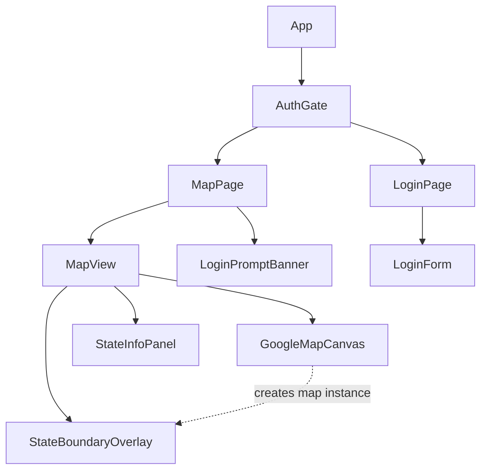
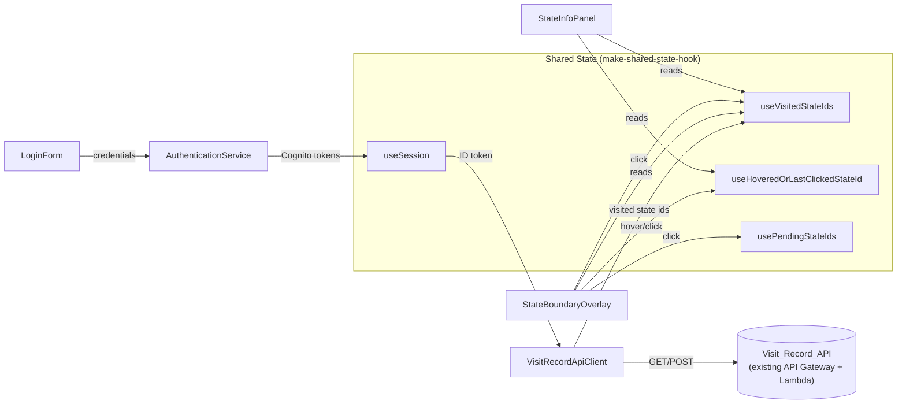
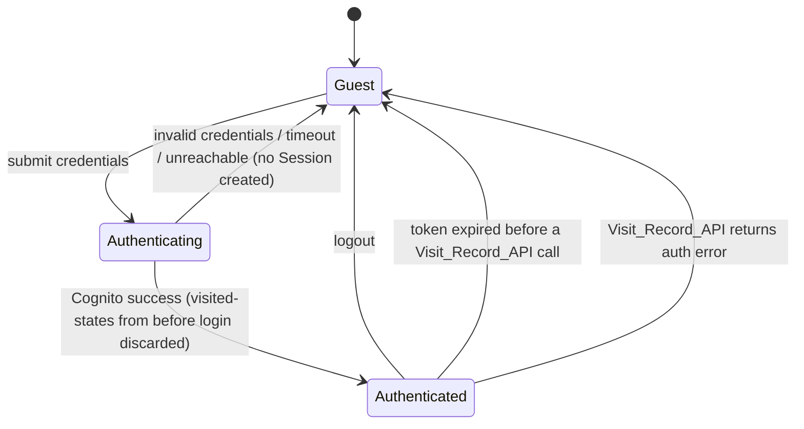
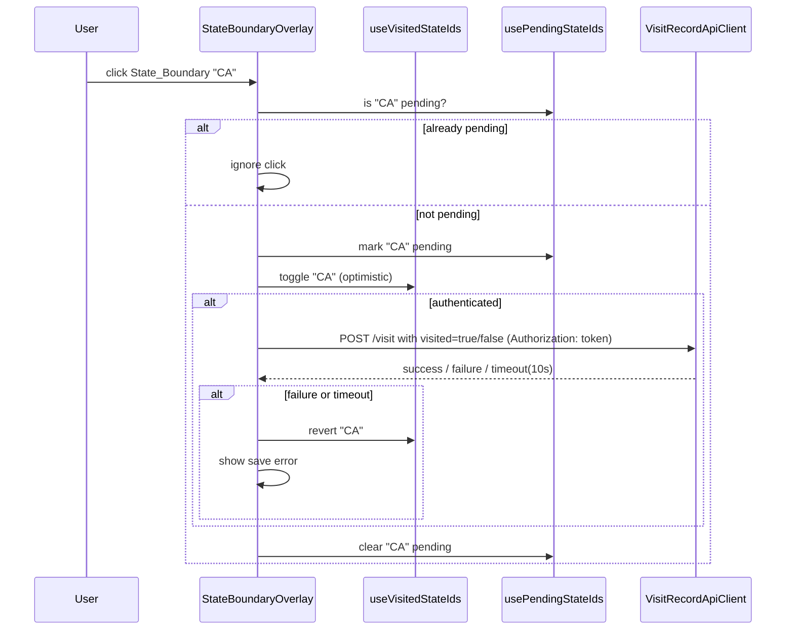

# Design Document: State Visit Tracker (Coordinate Commons Front End)

## Overview

Coordinate Commons is a React single-page application that shows a Google Map of the 50 US states plus Washington D.C. (51 regions). Visitors can click a state to mark or unmark it as "visited." Marks made while signed in are persisted to an existing AWS API Gateway + Lambda backend (the Visit_Record_API), scoped to the signed-in user's AWS Cognito identity. Marks made without signing in live only in memory for that browser session.

This design covers only the front end. The Visit_Record_API and the Cognito user pool already exist; this document defines the contract the front end assumes for them (see "Visit_Record_API Contract" below) but does not design their implementation.

The application is implemented in plain JavaScript (JSX), consistent with the `make-shared-state-hook` library's own examples and its no-framework, minimal-dependency philosophy. No build-time type system (TypeScript, Flow) is assumed or required by this design; PropTypes may optionally be used for component prop validation but are not load-bearing for correctness.

### Key Design Decisions

| Decision | Choice | Rationale |
|---|---|---|
| Map rendering | Google Maps JavaScript API, loaded via a small loader hook (no wrapper library like `@react-google-maps/api`) | Requirement 8.2/8.3 mandate the Google Maps JavaScript API directly. A thin loader keeps the dependency surface small and gives full control over overlay lifecycle, matching the project's stated preference for minimal dependencies. |
| State boundary hit-testing | A single map-level click/mousemove listener plus a pure, testable point-in-region lookup function, rather than one Google Maps click listener per polygon | Centralizing hit-testing in a pure function (`resolveRegionAtLatLng`) makes Requirement 3.5/3.6 and Requirement 10's hover behavior property-testable without a real Maps API instance, and gives deterministic behavior when polygons are near shared borders. |
| Authentication | `amazon-cognito-identity-js` (the Cognito Identity SDK) rather than the full AWS Amplify library | The app only needs username/password authentication against an existing user pool (no sign-up, no hosted UI, no other Amplify categories). `amazon-cognito-identity-js` is the lighter-weight, focused dependency for this single need and avoids pulling in Amplify's broader surface area. |
| Shared state | `make-shared-state-hook`, per Requirement 8.6/8.7 | Mandated by requirements. Per the library's own best practices, state is decomposed into several small hooks (session, visited-state ids, hovered/last-clicked id, pending-request ids) rather than one large object. |
| Visit_Record_API client | A small fetch-based client module, not a generated SDK | The API surface is 2 operations (list, save-with-visited-flag — unmarking reuses the save operation with `visited: false` rather than a separate delete). A hand-written client keeps the Authorization-header and timeout logic in one auditable place (Requirement 7). |
| State boundary source data | A single static GeoJSON asset, one Feature per region, each with a stable `stateId` (USPS 2-letter code, `DC` for the district), fetched at runtime via `fetch()` from a static path/CDN URL rather than imported into the JS bundle | Boundaries are fixed reference data, but they are also large relative to the app's core logic. Fetching them at runtime keeps them out of the JS bundle, reducing initial page load size; the boundary data loads in parallel with (or just after) the critical UI shell, at the cost of an extra loading/error state that the Map_View already needs to handle for the Maps API itself. |
| Configuration | A single `config.js` module exported as the sole source of the Visit_Record_API base URL, Cognito settings, and Google Maps API key | Keeps every environment-specific value (which differs between local/dev/staging/prod) in one auditable place, and avoids hardcoding the API's base URL, Cognito pool/client ids, or the Maps key across multiple files. |

## Architecture

### Component Tree



- **App**: Top-level component. Instantiates the shared-state hooks module and renders `AuthGate`.
- **AuthGate**: Reads the shared `useSession` hook and chooses between `MapPage` (default, per Requirement 1.1) and `LoginPage`.
- **MapPage**: Composes `MapView` and, for unauthenticated sessions, `LoginPromptBanner` (Requirement 9.2/9.3).
- **MapView**: Owns Google Maps lifecycle (loading, error, retry) and renders `GoogleMapCanvas`, `StateBoundaryOverlay`, `StateInfoPanel`.
- **StateBoundaryOverlay**: Draws the 51 region polygons on the map and colors them from `useVisitedStateIds` (Requirement 6).
- **StateInfoPanel**: Fixed-position panel below the map (Requirement 10).
- **LoginPage / LoginForm**: Username/password form calling `AuthenticationService`.

### Data Flow



### Session Lifecycle (Requirements 1, 2, 7)



### Toggle Sequence (Requirements 5, 7)



## Components and Interfaces

### Shared State Module (`sharedState.js`)

Built with `makeSharedStateHook(React, initialValue)`, one hook per independent piece of data (per the library's documented best practice of decomposing state):

```javascript
import React from 'react';
import { makeSharedStateHook } from 'make-shared-state-hook';

// Session: null when signed out, otherwise { username, accessToken, expiresAt }
export const useSession = makeSharedStateHook(React, null);

// Visited states: an object map of { [stateId]: true } for O(1) membership checks
export const useVisitedStateIds = makeSharedStateHook(React, {});

// Hover/last-click info panel target: null | stateId
export const useInfoPanelStateId = makeSharedStateHook(React, null);

// Set of stateIds with an in-flight save request: { [stateId]: true }
export const usePendingStateIds = makeSharedStateHook(React, {});

// Non-fatal, user-visible transient error banners (e.g. "update did not save")
export const useToastError = makeSharedStateHook(React, null);
```

`Session` shape:

```javascript
{
  username: string,
  accessToken: string,   // Cognito ID token (JWT)
  expiresAt: number,     // epoch ms; derived from Cognito's expires_in at sign-in time
}
```

### Configuration Module (`config.js`)

A single module exporting a plain object (or a small `getConfig()` accessor) with the following shape:

```javascript
export const config = {
  visitRecordApiBaseUrl: string,   // e.g. "https://api.example.com/prod" — base URL for the Lambda/API Gateway backend, distinct from the app's own origin
  googleMaps: {
    apiKey: string,                // Google Maps JavaScript API key
  },
  cognito: {
    userPoolId: string,            // AWS Cognito user pool id
    clientId: string,              // Cognito app client id
    region: string,                // AWS region of the user pool, e.g. "us-east-1"
  },
};
```

This module is the single source of truth for environment-specific values, so that `visitRecordApiClient.js`, `authenticationService.js`, and the Google Maps script loader (`useGoogleMapsLoader()`) all import from it rather than hardcoding values.

These values are build-time/deploy-time configuration (e.g., populated via environment variables at build time, or a static `config.js` checked in per environment) — this design does not prescribe the exact mechanism (env vars vs. per-environment file vs. runtime-fetched JSON), only that all three consumers read from this one module. **Open question / assumption to confirm during implementation**: which mechanism the project prefers for populating these values per environment.

The Google Maps API key and Cognito client id are inherently client-visible (shipped to the browser), and this is expected/acceptable for these particular values — standard for an SPA + Cognito app client without a client secret, and for Google Maps JS API keys restricted by HTTP referrer. This module is not for secrets.

### AuthenticationService (`authenticationService.js`)

Wraps `amazon-cognito-identity-js`. The underlying `CognitoUserPool` is constructed from `config.cognito.userPoolId` and `config.cognito.clientId`, and the SDK is configured for `config.cognito.region`.

```javascript
/**
 * Attempts to authenticate against the configured Cognito user pool.
 * Resolves with a Session object on success.
 * Rejects with { kind: 'INVALID_CREDENTIALS' | 'TIMEOUT_OR_UNREACHABLE' } on failure.
 * Enforces a 10-second timeout (Requirement 1.5, 1.9).
 */
async function login(username, password) { /* ... */ }
```

- Applies the field-length and required-field validation from Requirement 1.3/1.4 via `validateCredentials(username, password)` (pure function, exported separately for testing — see Property 1).
- Never resolves with a Session unless Cognito itself reports success (Property 3).

### VisitRecordApiClient (`visitRecordApiClient.js`)

```javascript
/** Throws/rejects with { kind: 'AUTH_ERROR' | 'TIMEOUT' | 'FAILURE' } as appropriate. */
async function listVisitedStates(session) { /* GET, 10s timeout; maps placesVisited[].Id -> stateId[] */ }
async function saveVisitedState(session, stateId, visited) { /* POST, 10s timeout */ }
```

Request URLs are built as `` `${config.visitRecordApiBaseUrl}/visit` `` rather than a relative path, since the API's base URL differs from the app's own origin. The GET (list) request appends a `?placeType=us-state` query parameter, required by the real backend; the POST (save) request does not, since it already conveys `placeType` in its JSON body.

Every function:
1. Returns immediately without a network call if `session` is `null` (Requirement 7.2 / Property 16).
2. Attaches `Authorization: <session.accessToken>` to the request (Requirement 7.1 / Property 15).
3. Classifies any `401`/`403` response as `AUTH_ERROR`, letting the caller clear the Session (Requirement 2.3/7.3 / Property 6).
4. Aborts and rejects with `TIMEOUT` if no response arrives within 10 seconds (`AbortController`).

`listVisitedStates` parses the response body's `placesVisited` array (each entry `{ "Id": "AZ" }`) and returns the corresponding array of `stateId`s (mapping each entry's `Id` field). `saveVisitedState` sends `visited` (`true` to mark, `false` to unmark) and does not use a separate delete call — unmarking reuses the same endpoint.

#### Visit_Record_API Contract (real backend, confirmed)

The backend already exists; this is its actual contract. If the real endpoints are later found to differ further, only `visitRecordApiClient.js` needs to change.

| Operation | Method & Path | Auth | Request Body | Success | Failure |
|---|---|---|---|---|---|
| List visited states | `GET /visit?placeType=us-state` | `Authorization: <token>` | none | `200 { "placesVisited": [ { "Id": "AZ" }, ... ] }` (empty array if none) | `401`/`403` → auth error; network/timeout → failure |
| Save/toggle visited state | `POST /visit` | `Authorization: <token>` | `{ "placeId": "IA", "placeType": "us-state", "visited": true }` (or `false` to unmark) | `200 { "username": "<user id>", "placeId": "IA", "visited": true }` | `401`/`403` → auth error; other non-2xx/timeout → failure |

There is no delete endpoint. Unmarking a visited state is performed by calling `POST /visit` with `"visited": false` instead of `true`. `placeType` is always the literal string `"us-state"` for this feature (used for both actual states and Washington D.C.).

### StateBoundaryData (`stateBoundaries.js` + runtime-fetched GeoJSON)

Region boundary data is no longer imported statically; it is fetched at runtime by a loader hook:

```javascript
/** Fetches and parses the boundary GeoJSON asset on mount.
 *  Exposes status: 'loading' | 'ready' | 'error', and `regions` once ready.
 *  `retry()` re-issues the fetch after a failure. */
function useRegionsLoader() {
  // status: 'loading' | 'ready' | 'error'
  // regions: Region[] (empty until status === 'ready')
  // retry(): void
}
```

```javascript
// One entry per region, id is the USPS 2-letter code ("DC" for the district).
{ stateId: 'CA', name: 'California', polygons: [[[lng, lat], ...], ...] }
```

```javascript
/** Pure function used for click hit-testing and (indirectly) hover.
 *  Returns the stateId whose region contains latLng, or null. */
function resolveRegionAtLatLng(latLng, regions) { /* ray-casting point-in-polygon */ }
```

`resolveRegionAtLatLng` remains a pure function operating on the `regions` array once `useRegionsLoader()` reports `ready`; it is the single source of truth backing Requirement 3.5/3.6, so it is exercised directly by Property 7 without needing a live Google Maps instance or a live fetch.

### MapView / StateBoundaryOverlay

- Loads the Google Maps JavaScript API script once (shared loader hook `useGoogleMapsLoader()`), exposing `status: 'loading' | 'ready' | 'error'`, and independently loads the region boundary data via `useRegionsLoader()`, exposing its own `status: 'loading' | 'ready' | 'error'`. `useGoogleMapsLoader()` builds the script-tag URL using `config.googleMaps.apiKey` rather than a hardcoded key. The Map_View's loading indicator (Requirement 3.3) covers both: it SHALL remain visible while either the map script or the boundary fetch is still loading, and SHALL clear only once both report `ready`. The error/retry control (Requirement 3.4) SHALL appear if either fails, identifies which one failed (map script, boundary data, or both), and its retry action re-attempts whichever of the two is still in an `error` state.
- On both `useGoogleMapsLoader()` and `useRegionsLoader()` reporting `ready`, creates one `google.maps.Map` fitted (via fixed center/zoom, not `fitBounds`, to avoid a load-order race) to a viewport that includes Alaska and Hawaii (Requirement 3.1).
- Renders each region as a `google.maps.Polygon`, with fill color derived from `resolveFillColor(stateId, visitedStateIds)` (Property 14).
- Registers exactly one `click` and one `mousemove`/`mouseout` listener on the `Map` object (not per-polygon), converts the event's `latLng` via `resolveRegionAtLatLng`, and:
  - on click: invokes the toggle handler described below if a region was hit; does nothing otherwise (3.6).
  - on mousemove: updates `useInfoPanelStateId` when the hit region changes; on mouseout (or moving to no region), clears it unless the device is touch-only (10.8 — see StateInfoPanel).

#### Toggle Handler (`handleStateBoundaryClick`)

Pure orchestration function (session, visitedStateIds, pendingStateIds, stateId, apiClient) → the next `{ visitedStateIds, pendingStateIds }` and the API call to issue, isolated from the DOM so it is directly property-testable (Properties 10, 11, 12, 13):

1. If `stateId` is in `pendingStateIds`, no-op (5.4).
2. Otherwise, flip membership of `stateId` in `visitedStateIds` immediately, mark `stateId` pending.
3. If `session` is present, issue a single `saveVisitedState` call with `visited` set to the new membership state (`true` when marking visited, `false` when unmarking); on failure/timeout, flip `stateId` back and set `useToastError`; either way, clear `stateId` from pending when the call settles (5.1–5.4).
4. If `session` is absent, skip step 3 entirely — no API call is made (5.5/5.6).

### StateInfoPanel

Rendered once, in a fixed position below `MapView`'s map element (not attached to the cursor), per 10.1.

```javascript
/** Pure function: what should the panel show right now?
 *  Returns { stateId: null } | { stateId, name, visited: boolean } */
function computeInfoPanelContent(infoPanelStateId, regionsById, visitedStateIds) { /* ... */ }
```

- `infoPanelStateId` is updated by hover (mousemove/mouseout on the map) on hover-capable devices, and by click on touch-only devices (detected once via `matchMedia('(hover: hover) and (pointer: fine)')`, consistent with Requirement 10.8) — this is the only place device capability is branched; `computeInfoPanelContent` itself is agnostic to how `infoPanelStateId` was set (Property 21).
- Because `computeInfoPanelContent` is a pure function of shared-state values, it re-renders whenever `useVisitedStateIds` changes even without pointer movement (10.6 / Property 20).

### LoginPage / LoginForm

- Client-side validation via `validateCredentials` (shared with `AuthenticationService`) blocks submission and shows "both fields are required" (or the appropriate length message) without calling Cognito (1.3/1.4).
- While `login()` is pending: submit control disabled, loading indicator shown (1.10).
- On `INVALID_CREDENTIALS`: shows "username or password is invalid", stays on Login_Page (1.8).
- On `TIMEOUT_OR_UNREACHABLE`: shows "login attempt could not be completed", re-enables submit, stays on Login_Page (1.9).
- On success: calls a callback that sets `useSession`, clears `useVisitedStateIds` to `{}`, and navigates to `MapPage`, which itself triggers the Requirement 4 load (1.6/1.7).

### LoginPromptBanner

Rendered by `MapPage` below `MapView` whenever `useSession` is `null` (9.2), never when it is non-null (9.3). Additionally distinguishes *why* the user is signed out when the transition to `null` was caused by expiration or an auth error, versus manual logout, by reading a short-lived `signOutReason` value (`'LOGOUT' | 'SESSION_ENDED'`) set alongside the session clear (2.4).

## Data Models

<!-- Note: config.js's shape is documented in its own subsection above ("Configuration Module") and is not part of Shared_State_Store — it holds build/deploy-time settings, not application state. -->

```javascript
// Session (see Shared State Module above)
Session = null | {
  username: string,
  accessToken: string,
  expiresAt: number,
}

// Region (static reference data; Region[] is populated asynchronously via
// useRegionsLoader()'s runtime fetch rather than a static import)
Region = {
  stateId: string,       // USPS code, e.g. "CA"; "DC" for the district
  name: string,          // e.g. "California"
  polygons: number[][][] // one or more linear rings of [lng, lat] pairs
}

// Visited-state membership map (Shared_State_Store)
VisitedStateIds = { [stateId: string]: true }   // absent key == not visited

// Pending-request membership map
PendingStateIds = { [stateId: string]: true }

// Visit_Record_API response shapes (see contract table) — two distinct shapes:
// List response entry: { Id: string }                      // e.g. { "Id": "AZ" }
// Save response:        { username: string, placeId: string, visited: boolean }
// VisitRecordApiClient normalizes both into the internal VisitedStateIds map
// (keyed by stateId), so callers never see these raw shapes directly.
VisitedStateListEntry = { Id: string }
VisitedStateSaveResponse = { username: string, placeId: string, visited: boolean }
```

## Correctness Properties

*A property is a characteristic or behavior that should hold true across all valid executions of a system—essentially, a formal statement about what the system should do. Properties serve as the bridge between human-readable specifications and machine-verifiable correctness guarantees.*

### Property 1: Credential validation accepts only well-formed, non-empty input

For any generated username and password strings, `validateCredentials(username, password)` accepts if and only if both are non-empty after trimming and within their maximum lengths (username ≤ 128 characters, password ≤ 256 characters); otherwise it rejects with a required-fields or length message.

**Validates: Requirements 1.3, 1.4**

### Property 2: Successful login discards prior visited-state data

For any prior `visitedStateIds` map (including empty) and any successful Cognito authentication result, applying the login-success handler always yields a `visitedStateIds` of `{}` and a non-null `Session` populated from that result.

**Validates: Requirements 1.6**

### Property 3: A failed or unreachable authentication attempt never creates a Session

For any Cognito outcome classified as invalid credentials, timeout, or unreachable, applying the login handler to any prior `Session` value always yields `Session === null` and never a populated Session.

**Validates: Requirements 1.8, 1.9, 8.5**

### Property 4: Logout always clears session and visited-state data

For any prior `Session` (including null) and any prior `visitedStateIds` map, applying the logout handler always yields `Session === null` and `visitedStateIds === {}`.

**Validates: Requirements 2.1**

### Property 5: An expired ID token blocks the API call and clears the session

For any `Session` whose `expiresAt` is before the current time, attempting any Visit_Record_API operation never issues a network request, and always clears the Session.

**Validates: Requirements 2.2**

### Property 6: An authentication-error response always clears the session

For any Visit_Record_API response classified as an authentication error (401/403), the response handler always clears the Session, regardless of which operation (list/save) produced it.

**Validates: Requirements 2.3, 7.3**

### Property 7: Region hit-testing resolves clicks to exactly the containing region, or none

For any generated latitude/longitude point and any set of non-overlapping region polygons, `resolveRegionAtLatLng` returns the `stateId` of the one region whose polygon contains that point, or `null` if no region's polygon contains it.

**Validates: Requirements 3.5, 3.6**

### Property 8: Loading visited states replaces the store with exactly what the API returned

For any prior `visitedStateIds` map and any list of `stateId`s returned by the Visit_Record_API (including the empty list), the load-success handler always results in a `visitedStateIds` map whose keys are exactly that returned list, regardless of what was present before the response arrived.

**Validates: Requirements 4.3**

### Property 9: Guest initialization never calls the API and preserves local marks

For any pre-existing local (session-only) `visitedStateIds` map and an unauthenticated session, initializing the Map_View for a guest always results in `visitedStateIds` unchanged from its prior local value, and issues zero calls to the Visit_Record_API client.

**Validates: Requirements 4.7**

### Property 10: Clicking a state as an authenticated user always toggles it and issues the matching request

For any authenticated `Session`, any `stateId` not currently pending, and its current visited membership, `handleStateBoundaryClick` always flips that `stateId`'s membership in `visitedStateIds` and issues a `saveVisitedState` request with `visited: true` if it was being marked visited, or `visited: false` if it was being unmarked.

**Validates: Requirements 5.1, 5.2**

### Property 11: A failed or timed-out save always reverts the optimistic update

For any authenticated `Session`, any `stateId`, and a Visit_Record_API save call mocked to fail or time out, the resulting `visitedStateIds` membership for that `stateId` always equals its value immediately before the click, and a save-error is surfaced.

**Validates: Requirements 5.3**

### Property 12: Repeated clicks on a pending state have no additional effect

For any `stateId` already marked pending and any number of additional click events dispatched on it before the in-flight request settles, `visitedStateIds` and the count of issued API calls for that `stateId` remain exactly what they were after the first click (idempotence of repeated clicks while pending).

**Validates: Requirements 5.4**

### Property 13: Clicking a state as an unauthenticated user always toggles it locally and never calls the API

For any unauthenticated session, any `stateId` not currently pending, and its current visited membership, `handleStateBoundaryClick` always flips that `stateId`'s membership in `visitedStateIds` and issues zero calls to the Visit_Record_API client.

**Validates: Requirements 5.5, 5.6**

### Property 14: Fill color is exactly one of two fixed, distinct colors, determined solely by membership

For any `stateId` and any `visitedStateIds` map, `resolveFillColor(stateId, visitedStateIds)` returns the visited-fill-color if and only if `stateId` is a key in `visitedStateIds`, and otherwise returns the not-visited-fill-color; the two colors are never equal.

**Validates: Requirements 6.1, 6.3**

### Property 15: Every Visit_Record_API request carries the session's ID token as the Authorization header

For any non-null `Session` and any of the two operations (list/save), the outgoing request's `Authorization` header always equals `session.accessToken`.

**Validates: Requirements 7.1**

### Property 16: No session means no request is ever sent

For any of the two Visit_Record_API operations invoked with `session === null`, the underlying transport (fetch) is never called, and the function resolves/rejects without a network round trip.

**Validates: Requirements 7.2**

### Property 17: The login prompt is visible exactly when there is no session

For any `Session` value (`null` or populated), `shouldShowLoginPrompt(session)` returns `true` if and only if `session === null`.

**Validates: Requirements 9.2, 9.3**

### Property 18: The info panel always displays the currently targeted region's name and visited status

For any non-null `infoPanelStateId` that identifies a known region, and any `visitedStateIds` map, `computeInfoPanelContent` returns that region's name and a `visited` flag equal to the region's membership in `visitedStateIds` — including when `infoPanelStateId` changes directly from one region to a different one.

**Validates: Requirements 10.2, 10.4**

### Property 19: The info panel shows the neutral placeholder whenever nothing is targeted

For any `visitedStateIds` map, `computeInfoPanelContent(null, regionsById, visitedStateIds)` always returns the placeholder content (no name, no visited status).

**Validates: Requirements 10.3, 10.5**

### Property 20: The info panel reflects visited-status changes for the currently targeted region without re-targeting

For any fixed `infoPanelStateId` targeting a known region, and any two `visitedStateIds` maps that differ only in that region's membership, `computeInfoPanelContent` returns a different `visited` flag matching each map, with `stateId`/`name` unchanged.

**Validates: Requirements 10.6**

### Property 21: On hover-incapable devices, the info panel always reflects the most recent click

For any sequence of one or more clicked `stateId`s on a simulated touch-only device, `infoPanelStateId` after the sequence always equals the last `stateId` in that sequence, regardless of any hover-like events interleaved in the sequence.

**Validates: Requirements 10.8**

## Error Handling

| Failure | Detection | Front-end behavior | Requirement |
|---|---|---|---|
| Google Maps script fails to load, runtime boundary GeoJSON fetch fails (network error, non-200 response, malformed JSON), or overlay construction throws | Script `onerror`; `useRegionsLoader()` catching a fetch rejection, non-2xx status, or JSON parse error; or overlay construction throwing | Show error message + retry control in Map_View, identifying which of the two failed; retry re-attempts whichever is in error | 3.4 |
| Login request times out or Cognito unreachable | `amazon-cognito-identity-js` callback error / 10s `AbortController` | Show "could not be completed" message, re-enable submit, stay on Login_Page | 1.9 |
| Invalid credentials | Cognito `NotAuthorizedException` / `UserNotFoundException` | Show "username or password is invalid", stay on Login_Page | 1.8 |
| Visited-state list request fails or times out | Client throws `TIMEOUT`/`FAILURE` | Show error + retry control in Map_View | 4.4 |
| Visited-state list request returns auth error | Client throws `AUTH_ERROR` | Clear Session, show Map_View with login prompt ("session ended") | 2.3, 7.3 |
| Visit-save request (marking or unmarking) fails or times out | Client throws `TIMEOUT`/`FAILURE` | Revert optimistic toggle, show transient save-error toast | 5.3 |
| Visit-save request (marking or unmarking) returns auth error | Client throws `AUTH_ERROR` | Clear Session, show Map_View with login prompt ("session ended"); also revert the optimistic toggle since the write did not persist | 2.3, 7.3, 5.3 |
| ID token expired before a call | `session.expiresAt < Date.now()` checked before every call | Clear Session, show Map_View with login prompt ("session ended"), skip the call entirely | 2.2 |
| Click on a location with no containing region | `resolveRegionAtLatLng` returns `null` | No state-identification action taken | 3.6 |
| Duplicate click while a request is pending | `stateId` present in `pendingStateIds` | Click ignored entirely (no state change, no request) | 5.4 |

## Testing Strategy

**Language/tooling**: JavaScript (JSX), Jest as the test runner, React Testing Library for component-level unit/integration tests, and `fast-check` as the property-based testing library (minimum 100 runs per property, configured via `fc.assert(fc.property(...), { numRuns: 100 })`). Each property test is tagged in a comment referencing its design property, e.g. `// Feature: state-visit-tracker, Property 7: Region hit-testing resolves clicks to exactly the containing region, or none`.

**Property tests** cover the 21 properties above, exercised against the pure functions they name (`validateCredentials`, the login/logout/session-clearing handlers, `resolveRegionAtLatLng`, `handleStateBoundaryClick`, `resolveFillColor`, the Visit_Record_API client's header/short-circuit behavior (list and save, with `visited: true`/`false`) with a mocked `fetch`, `shouldShowLoginPrompt`, `computeInfoPanelContent`). None of these require a live Google Maps instance, a live Cognito pool, or a live Visit_Record_API — all external calls are mocked at the `fetch` / Cognito SDK boundary, keeping iteration cost low.

**Unit/example tests** cover the scenarios identified as EXAMPLE in the acceptance-criteria prework: default view and login-control visibility (1.1, 1.2), loading/disabled-state UI during login (1.10), the specific invalid-credentials and timeout error messages (1.8, 1.9), the fixed initial map viewport and exactly-51-regions data integrity check (3.1, 3.2), map-script and runtime boundary-fetch loading/error/retry UI, including the combined loading indicator and per-source retry behavior, with `fetch` mocked at the component level (3.3, 3.4), the 10-second timeout behavior for the initial visited-states load and its retry control (4.1, 4.2, 4.4, 4.5), the sign-out-reason wording distinction (2.4), color-update timing after a state change (6.2), the fixed (non-tooltip) positioning of the State_Info_Panel (10.1), and smoke tests confirming the Google Maps script loads and both a map and the region overlay are actually constructed (8.2, 8.3, 8.4).

**Integration tests** cover end-to-end wiring across the mocked API boundary: successful login followed by the Requirement 4 load populating the map (1.6/1.7 combined), and a guest's local marks persisting only in memory across a re-render without any Visit_Record_API calls (9.1/9.4 combined).

This dual approach follows the project-wide convention: property tests give broad, randomized input coverage of the pure logic layer (validation, toggling, hit-testing, color/display derivation, request construction), while unit and integration tests pin down the small number of concrete UI states, error messages, and wiring scenarios that don't vary meaningfully with input.
